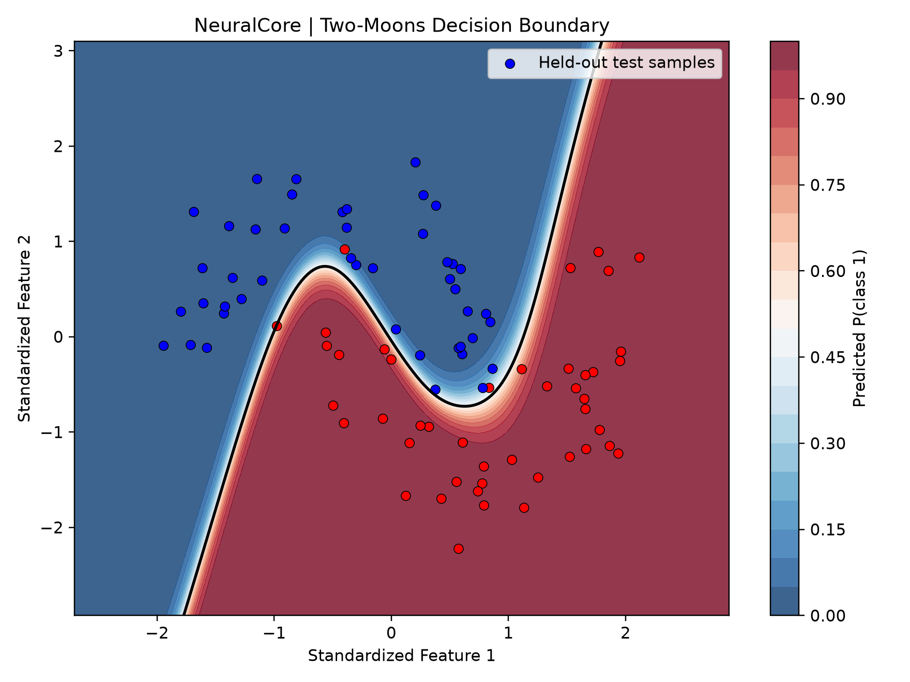
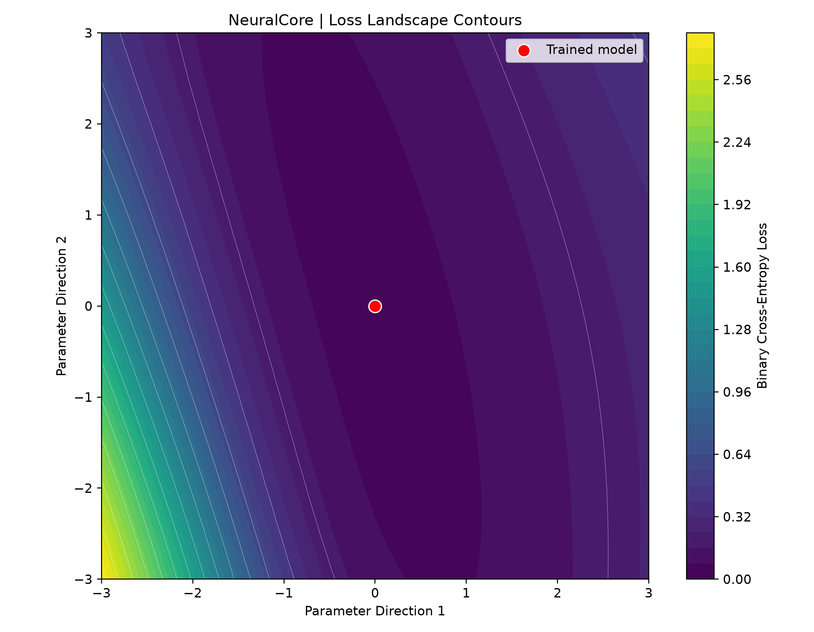
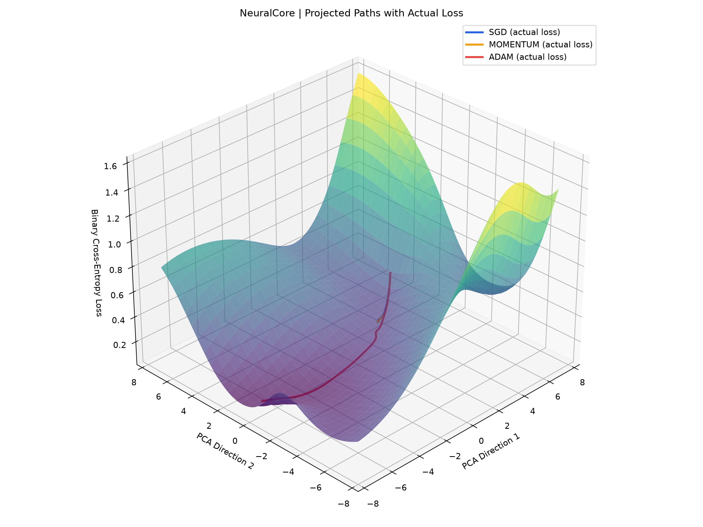
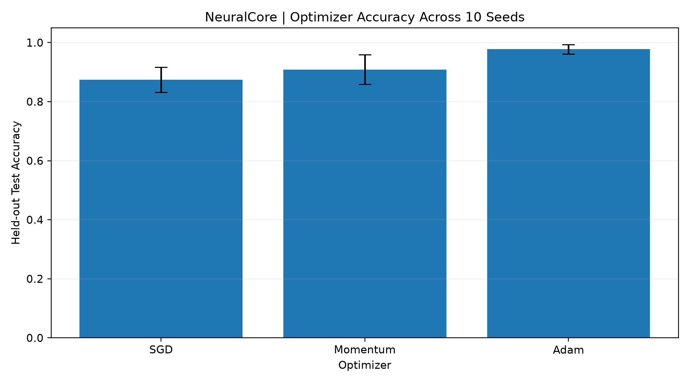
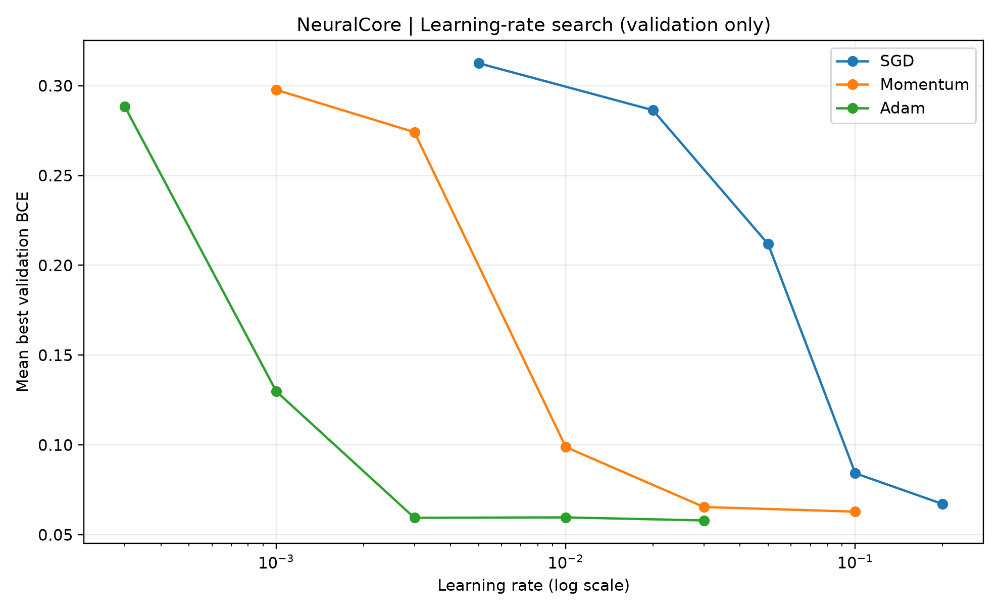
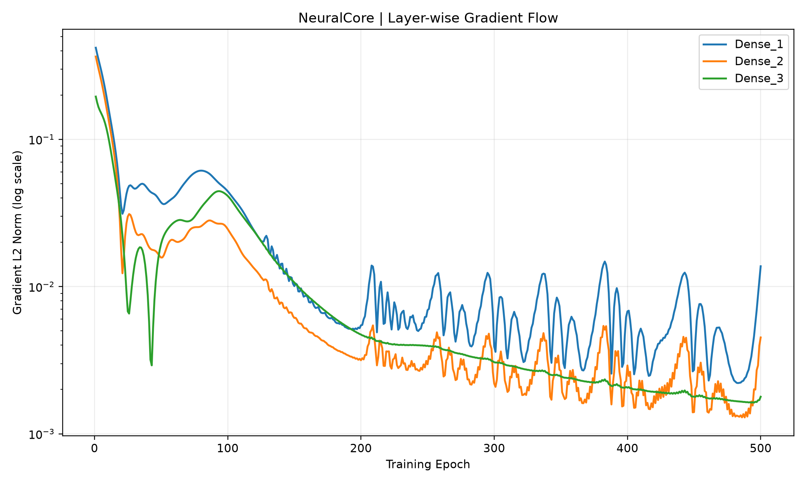
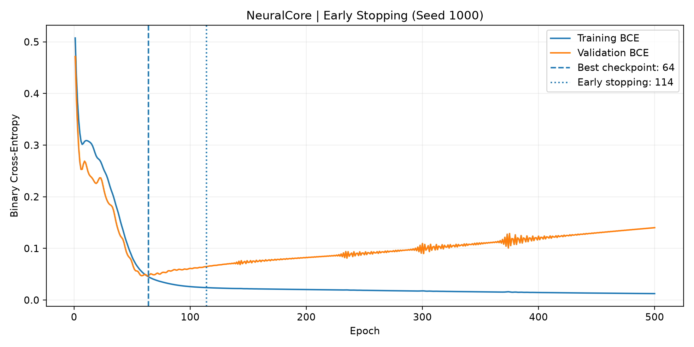
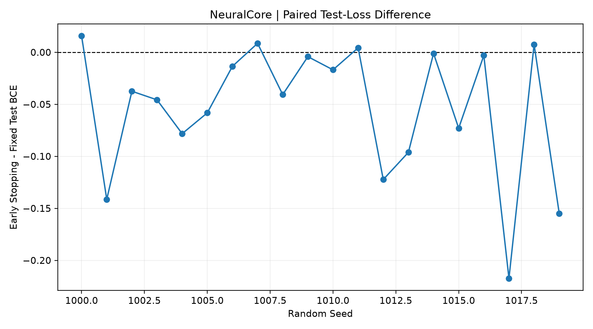

# NeuralCore
### Neural Networks from Scratch — A NumPy-Based Research and Experimentation Framework

NeuralCore is a neural-network framework built from scratch using NumPy. It implements fundamental deep-learning components without relying on automatic differentiation or high-level deep-learning frameworks such as PyTorch or TensorFlow.

The project combines neural-network engineering with controlled experiments, statistical evaluation, numerical diagnostics, and reproducibility checks.

## Project Objectives

- Implement forward propagation and backpropagation from first principles.
- Build reusable dense layers, activation functions, loss functions, and optimizers.
- Verify analytical gradients against numerical approximations.
- Investigate optimization behaviour and loss landscapes.
- Compare optimizers across multiple random seeds.
- Evaluate hyperparameters using separate tuning and evaluation seeds.
- Examine gradient flow, update ratios, and training dynamics.
- Study the effects of early stopping on generalization.
- Validate the implementation through automated tests and reproducibility audits.

## Architecture

The framework is organized into three main components:

**Core engine (`neuralcore/`)**

Contains the neural-network implementation, including layers, activations, losses, optimizers, datasets, diagnostics, and early stopping.

**Experiments (`experiments/`)**

Contains controlled training experiments, optimizer comparisons, hyperparameter evaluation, gradient diagnostics, loss-landscape visualizations, and reproducibility auditing.

**Tests (`tests/`)**

Contains automated tests covering mathematical operations, model behaviour, experiment utilities, and research-audit functionality.

## Core Features

### Neural Network Engine

- Dense fully connected layers
- Forward and backward propagation
- Activation functions and their derivatives
- Binary cross-entropy with logits
- Sequential network construction
- Numerical gradient verification
- Parameter updates using SGD, Momentum, and Adam

### Data Preparation

- Synthetic XOR and two-moons datasets
- Seed-controlled data generation
- Train/validation/test splitting
- Feature scaling fitted using training data

### Optimization Research

- Controlled optimizer comparisons
- Multi-seed benchmarking
- Paired bootstrap confidence intervals
- Hyperparameter selection and evaluation using separate seed groups
- Optimizer trajectories and loss-landscape visualizations

### Training Diagnostics

- Layer-wise gradient norms
- Parameter update ratios
- Gradient-history reporting
- Validation-loss monitoring
- Early stopping with best-checkpoint restoration

## Selected Experimental Findings

### Optimizer Comparison

In the initial fixed-hyperparameter benchmark, Adam achieved higher mean test accuracy than SGD and Momentum.

After learning-rate tuning and evaluation on separate seeds, the performance differences narrowed substantially.

This illustrates why optimizer comparisons should account for hyperparameter selection rather than relying on a single arbitrary learning rate.

### Early Stopping

A paired experiment compared the final checkpoint after 500 epochs against a validation-selected checkpoint, using the same training trajectory for each of 20 random seeds.

| Metric | Fixed Training | Early Stopping |
|---|---:|---:|
| Mean test accuracy | 96.94% | 97.61% |
| Mean F1 | 0.9693 | 0.9761 |
| Mean test BCE | 0.12666 | 0.07327 |
| Mean checkpoint epoch | 500 | 181.9 |
| Mean simulated training epochs | 500 | 231.9 |

The mean paired accuracy improvement was **+0.67 percentage points**, with a 95% paired bootstrap confidence interval of approximately **+0.17 to +1.22 percentage points**.

The mean paired test-loss difference was **−0.05339 BCE**, with a 95% paired bootstrap confidence interval of approximately **−0.08259 to −0.02687**.

The experiment executed the full 500-epoch trajectory to enable paired checkpoint comparison. Consequently, the reported early-stopping epoch savings are simulated rather than measured runtime savings.

These findings apply to the experimental configuration and synthetic dataset used here; they do not establish universal superiority.

## Installation

Python 3.13.5 was used for the recorded development environment.

Create a virtual environment:

```powershell
python -m venv .venv
```

Activate it in PowerShell:

```powershell
.\.venv\Scripts\Activate.ps1
```

Install the recorded dependencies:

```powershell
python -m pip install -r requirements.txt
```

## Run Tests

```powershell
python -m pytest -q
```

At the documented development checkpoint, the test suite reported:

**216 passed**

## Run Experiments

From the project root:

```powershell
python -m experiments.xor_training
python -m experiments.moons_training
python -m experiments.optimizer_benchmark
python -m experiments.hyperparameter_search
python -m experiments.gradient_flow
python -m experiments.early_stopping_comparison
```

Some experiments perform repeated training runs and may take longer to complete.

## Run Reproducibility Audit

```powershell
python -m experiments.reproducibility_audit
```

At the documented development checkpoint:

**17/17 checks passed**

The audit checks dataset determinism, model initialization, selected artifact consistency, and research-output availability.

It does not independently rerun every training experiment or prove cross-platform numerical reproducibility.

## Research Documentation

See:

- `RESEARCH_REPORT.md` for experimental methodology, results, and limitations.
- `REPRODUCIBILITY.md` for environment information and reproducibility procedures.

## Technology Stack

- Python
- NumPy
- Matplotlib
- Pytest

Neural-network training and gradient computation are implemented without PyTorch, TensorFlow, or automatic differentiation.

## Limitations

- Experiments primarily use synthetic datasets.
- Results depend on the chosen architectures, learning rates, and random seeds.
- Bootstrap confidence intervals describe uncertainty across the evaluated seed pairs.
- Full cross-environment and cross-platform reproducibility has not been established.
- The early-stopping comparison estimates potential epoch savings rather than directly measuring runtime savings.

## Project Status

Research and experimentation framework implemented, with automated testing and an initial reproducibility audit completed.

Further work includes clean-environment and cross-platform reproducibility checks, additional research validation, and external-data evaluation.


## Independent Full-Training Reproducibility

NeuralCore independently trained two models for each of three
random seeds (42, 43, and 44), using Adam with learning rate
0.03 for 300 epochs.

All three independent seed pairs passed seven exact numerical
comparisons covering training loss histories, validation loss
histories, final parameters, test logits, test labels, test loss,
and classification metrics.

**Result: 3/3 seed pairs passed; 21/21 exact checks passed.**

Different-seed sensitivity also passed.

The experiment was conducted using Python 3.13.5 and
NumPy 2.5.4 on Windows 11.

These findings establish exact repeatability for this tested
configuration within the recorded environment, not across
different platforms or architectures.

Run the experiment:

``powershell
python -m experiments.full_training_reproducibility
``

Results are stored in:
`outputs/full_training_reproducibility/full_training_report.json`


---

## Research Visualizations

The following visualizations were generated from NeuralCore experiments using the NumPy-based neural-network implementation.

### 1. Nonlinear Classification



A learned decision boundary on the synthetic two-moons classification dataset.

### 2. Loss Landscape



A two-dimensional visualization of the neural-network loss landscape.

### 3. Optimizer Trajectories



Projected optimization trajectories illustrating how different optimizers navigate parameter space.

### 4. Multi-Seed Optimizer Benchmark



Comparison of SGD, Momentum, and Adam under the initial fixed-hyperparameter benchmark.

### 5. Hyperparameter Search



Validation-based learning-rate selection used to support a fairer optimizer comparison.

### 6. Gradient-Flow Diagnostics



Layer-wise gradient measurements used to investigate training dynamics.

### 7. Early Stopping



Training and validation-loss behaviour with validation-selected checkpoint information.

### 8. Paired Test-Loss Comparison



Held-out test-loss comparison between the fixed final checkpoint and validation-selected early-stopping checkpoint.

For experimental configurations, numerical results, statistical interpretation, and limitations, see [RESEARCH_REPORT.md](RESEARCH_REPORT.md).


